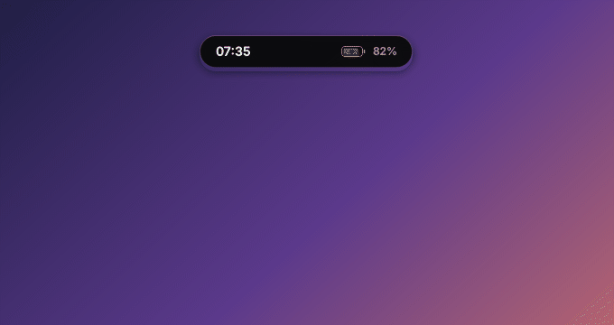
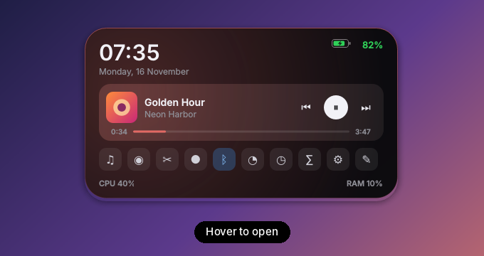

<div align="center">

# Laptop Dynamic Island

**A tiny pill at the top of your Windows screen that shows the time, battery and what's playing, and opens into quick controls when you hover over it.**




</div>

## Features

- **Collapsed pill:** clock, battery and a live equaliser with the album cover when something is playing.
- **Hover to open:** a spring-style animation opens the full panel. Click it to keep it open, click again to let it close.
- **Now playing:** works with Spotify, YouTube in a browser, VLC and anything else that uses Windows media controls. Shows the cover, a progress bar you can click to seek, and previous / play-pause / next buttons.
- **Cover-tinted:** the card and glow pick up the colour of the album art.
- **Real Bluetooth switch:** turn Bluetooth on and off with one click. The tile lights up when it's on.
- **Quick apps:** Camera, Snipping Tool, screen recorder, Wi-Fi, Clock, Calculator, Settings and a notepad. You can change them in `config.json`.
- **Global hotkey:** `Ctrl + Space` shows or hides the island instantly, even over admin windows.
- **Light on resources:** polling stops while the island is hidden, and only one copy can run at a time.
- **Tray icon:** a backup way to show, hide or quit it.



## Install

You need **Windows 10 or 11** and **Python 3.10 or newer** ([download](https://www.python.org/downloads/), tick *Add python.exe to PATH*).

```bash
git clone https://github.com/git-Snehal/Laptop-Dynamic-Island.git
cd Laptop-Dynamic-Island
run.bat
```

`run.bat` installs everything and starts the island. After that, start it without a console window by double-clicking **`start-island.vbs`**.

### Start with Windows

Double-click **`autostart-on.bat`**. It puts a shortcut in your Startup folder. Run **`autostart-off.bat`** to remove it. If you move the folder later, run off then on again.

## Using it

| Action | What happens |
| --- | --- |
| Hover over the pill | Opens the full panel |
| Click the pill | Keeps it open (click again to release) |
| Drag the pill | Moves it, and the position is remembered |
| `Ctrl + Space` | Shows or hides the island |
| Double-click `start-island.vbs` while running | Same as the hotkey |
| Click the progress bar | Seeks in the song |
| Right-click the Bluetooth tile | Opens Windows Bluetooth settings |
| Right-click the pill | Hide, reset position, quit |

If `Ctrl + Space` is already taken by another program or an input method, the island automatically uses `Ctrl + Alt + Space`. The tray tooltip tells you which one is active.

## Configuration

Everything lives in `config.json` and is picked up the next time you start the island.

| Key | Default | What it does |
| --- | --- | --- |
| `hotkey` | `"ctrl+space"` | Global shortcut. Modifiers: `ctrl`, `alt`, `shift`, `win`. Keys: letters, digits, `f1`-`f24`, `space`... |
| `clock_24h` | `true` | `false` for 12-hour time |
| `appearance.fill_opacity` | `0.98` | Pill opacity (0.88 to 1.0) |
| `appearance.accent_from_art` | `true` | Tint the island with the album cover's colour |
| `position` | `center` | Set automatically when you drag the pill |
| `quick_apps` | see file | The row of tiles in the panel |

### Quick apps

Each tile is one entry:

```json
{ "label": "Spotify", "glyph": "♫", "color": "#1DB954", "type": "uri", "target": "spotify:" }
```

| `type` | `target` | Example |
| --- | --- | --- |
| `uri` | Anything Windows can open | `ms-settings:display`, `https://example.com` |
| `exe` | A command | `calc`, `notepad` |
| `hotkey` | A key combination to press | `win+shift+s` |
| `bluetooth` | (empty) | The on/off switch |
| `notes` | (empty) | The built-in notepad (saved to `notes.txt`) |

Icons come from the Windows icon font (Segoe Fluent Icons). Custom tiles use `glyph` as their symbol.

## Troubleshooting

Open **`island.log`** in the app folder. It records whether the hotkey registered, whether the Bluetooth and media features loaded, and why a cover image failed to load.

| Problem | Fix |
| --- | --- |
| Nothing appears | Run `run.bat` and read the error. Python must be in PATH. |
| "Nothing playing" while music plays | Run `run.bat` again so the optional media packages install. |
| Bluetooth tile only opens Settings | The `winrt-Windows.Devices.Radios` package didn't install, or Windows refused access. |
| Hotkey does nothing | Another app owns the shortcut. Change `hotkey` in `config.json`. |
| Wrong position after changing monitors | Right-click the pill, then **Reset position to center**. |

## How it works

| File | Role |
| --- | --- |
| `island.py` | The window, animation, drawing, hover logic and the single-instance handling |
| `media.py` | Reads now-playing info, cover art and the timeline from Windows media controls |
| `bluetooth.py` | Switches the Bluetooth radio through the Windows Radio API |
| `winkeys.py` | Native global hotkey and key sending |

The window is a frameless, translucent Qt widget. The shadow, cover tint and edge light are painted by hand, and the panel is revealed by animating the window geometry.

## License

MIT. See [LICENSE](LICENSE).
